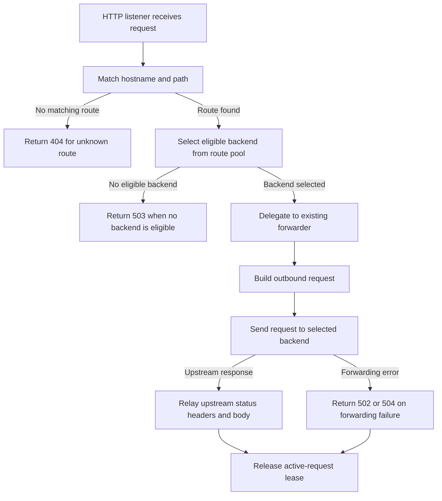
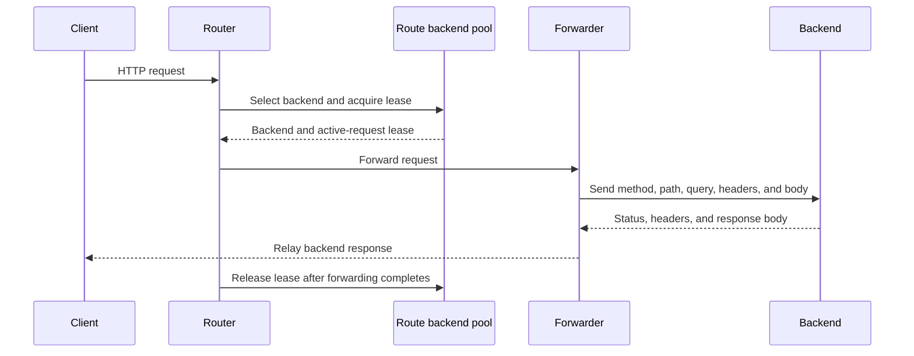

# Fluxgate

Fluxgate is an independently implemented HTTP reverse proxy and load balancer written in Go. It accepts HTTP requests, finds a route using the request hostname and path, selects a backend from that route's pool, and relays the backend response to the client. Fluxgate uses Go's HTTP client and server primitives, but implements the forwarding flow itself; it does not use `httputil.NewSingleHostReverseProxy` or another proxy product.

## What does a reverse proxy do?

A client normally sends a request directly to one server. A reverse proxy sits between clients and backend servers: clients connect to the proxy, and the proxy forwards each request to an appropriate backend. This gives clients one entry point while allowing the service behind it to use multiple routes and backend instances.

Fluxgate separates three decisions and actions:

- **Routing** identifies the route from the request hostname and path.
- **Load balancing** chooses one eligible backend from that route's pool.
- **Forwarding** sends the request to that backend and returns its response.

## Request lifecycle

The handler first matches a route, then asks its pool for a backend lease. The existing forwarder handles the HTTP exchange. The lease remains active for the full forwarding operation and is released even when forwarding fails.



The lease makes active-request tracking correspond to the whole proxied request rather than merely backend selection:



A backend connection failure returns `502 Bad Gateway`; an upstream timeout returns `504 Gateway Timeout`. If a route has no eligible backend, Fluxgate returns `503 Service Unavailable`. An unmatched route returns `404 Not Found`. SIGINT or SIGTERM starts graceful shutdown, bounded by `server.shutdown_timeout`.

## Routing

Every route maps a hostname and path prefix to its own backend pool.

- Hostnames match exactly and case-insensitively. The incoming port is ignored; wildcard hostnames are not supported.
- Path prefixes match at segment boundaries. `/users` matches `/users` and `/users/123`, but not `/usersettings`.
- `/` matches every path for its hostname.
- If multiple routes for a hostname match, the longest path prefix wins.
- Duplicate normalized hostname and path-prefix combinations are rejected during startup.
- Fluxgate does not rewrite paths. Query parameters are forwarded unchanged.

For example, a request to `api.example.com:8080/users/42?view=full` selects the route for `api.example.com` with the most specific matching prefix. The original `/users/42` path and `view=full` query are then passed upstream.

## Load balancing

Each route gets an independent backend pool initialized at startup. Backends start eligible. The pool can skip backends marked ineligible, but Phase 3 does not change eligibility automatically or perform health checks.

| Algorithm | Selection behavior | Weight behavior |
| --- | --- | --- |
| `round_robin` | Thread-safe sequential selection across eligible backends. | Weights are ignored. |
| `random` | Concurrent-safe, per-pool pseudorandom selection. | Selection probability is proportional to weight. |
| `least_connections` | Chooses the eligible backend with the fewest active proxied requests. Ties go to the earliest backend in configuration order. | Weights are ignored. |
| `weighted_round_robin` | Smooth weighted scheduling with one current-weight value per backend; it does not expand weights into a repeated list. | Higher weights receive proportionally more selections over time. |

Least connections measures active requests, not physical TCP connections: Go's HTTP transport may reuse connections. The algorithm is most useful when requests overlap; if requests are strictly sequential, each completed request releases its count before the next selection, so ties normally select the first configured backend.

Selecting a backend acquires an idempotent lease and increments its active-request counter. The router defers release until forwarding completes, including error paths. Balancer state uses synchronization and atomic counters so concurrent requests can safely select and release backends.

## Configuration

Edit `./configs/proxy.yaml`. Each route needs a unique name, hostname, path prefix, and one or more upstreams. An upstream URL must be an absolute HTTP or HTTPS URL without credentials, query, or fragment. Weights must be positive integers and default to `1`; an omitted algorithm defaults to `round_robin`.

```yaml
server:
  listen: ":8080"
  read_timeout: 15s
  write_timeout: 15s
  idle_timeout: 60s
  shutdown_timeout: 10s

proxy:
  timeout: 30s

routes:
  - name: users-api
    host: api.example.com
    path_prefix: /users
    load_balancer:
      algorithm: round_robin
    upstreams:
      - url: http://localhost:3001
        weight: 1
      - url: http://localhost:3002
        weight: 1
      - url: http://localhost:3003
        weight: 1

  - name: orders-api
    host: api.example.com
    path_prefix: /orders
    load_balancer:
      algorithm: least_connections
    upstreams:
      - url: http://localhost:4001
      - url: http://localhost:4002

  - name: weighted-api
    host: weighted.example.com
    path_prefix: /
    load_balancer:
      algorithm: weighted_round_robin
    upstreams:
      - url: http://localhost:5001
        weight: 3
      - url: http://localhost:5002
        weight: 1
```

For backwards compatibility, a route may use the Phase 2 single `upstream` field instead of `upstreams`. Fluxgate treats it as a one-backend pool with weight `1` and defaults to round robin. A route must not specify both fields. The checked-in sample in `./configs/proxy.yaml` uses the legacy field for its `localhost:8000` backend.

The only non-standard library dependency is `gopkg.in/yaml.v3`, which parses the YAML configuration; Go's standard library does not include a YAML parser.

## Request forwarding and headers

The forwarding engine creates a new outbound request while preserving the incoming method, path, query, and body. It copies end-to-end headers while removing hop-by-hop headers, including headers named by the incoming `Connection` header. Fluxgate carries the request's known content length into the outbound request; Go's HTTP transport handles transfer framing rather than copying the incoming `Transfer-Encoding` header.

The outbound `Host` is set to the upstream host. Fluxgate adds or updates `X-Forwarded-For`, `X-Forwarded-Proto`, and `X-Forwarded-Host` so backends can identify the original client and request host/protocol. On the response path it copies end-to-end response headers, status, and body, while removing hop-by-hop headers. Forwarding errors are logged internally without returning internal error details to clients.

## Prerequisites

- Ubuntu Linux (or another supported operating system)
- Go 1.22 or later
- `make` (optional)

On Ubuntu, install Go and Make using your preferred package source. For example:

```sh
sudo apt update
sudo apt install golang-go make
```

Check that the installed Go version is 1.22 or later before building.

## Build and run

From the project root:

```sh
go mod download
make build
./bin/fluxgate -config ./configs/proxy.yaml
```

Or run directly without building the binary first:

```sh
go run ./cmd/proxy -config ./configs/proxy.yaml
```

Fluxgate listens at the configured address (port 8080 in the sample). Press Ctrl+C to stop it; active requests are allowed to finish within `server.shutdown_timeout`.

## Run local backends and test distribution

Create a different response file for each backend so you can see which one served each request:

```sh
mkdir -p /tmp/fluxgate-3001/users /tmp/fluxgate-3002/users /tmp/fluxgate-3003/users
printf 'backend 3001\n' > /tmp/fluxgate-3001/users/index.html
printf 'backend 3002\n' > /tmp/fluxgate-3002/users/index.html
printf 'backend 3003\n' > /tmp/fluxgate-3003/users/index.html
```

Start one local server per terminal:

```sh
python3 -m http.server 3001 --directory /tmp/fluxgate-3001
```

```sh
python3 -m http.server 3002 --directory /tmp/fluxgate-3002
```

```sh
python3 -m http.server 3003 --directory /tmp/fluxgate-3003
```

Start Fluxgate using `./configs/proxy.yaml`. The `--resolve` option points the example hostname to the local proxy while retaining the HTTP `Host` header needed for routing:

```sh
for request in $(seq 1 9); do
  curl --silent --show-error --resolve api.example.com:8080:127.0.0.1 \
    'http://api.example.com:8080/users/index.html'
done
```

The sample's equal-weight round-robin route cycles through the three backends. For the weighted route, the configured weights `3` and `1` mean the first backend receives about three quarters of selections over time; the exact sequence is determined by the smooth scheduling algorithm.

## Tests

Run all tests, including the Phase 1 and Phase 2 coverage:

```sh
go test ./...
go test -race ./...
```

Or run the project test target:

```sh
make test
```

Tests use Go's testing package and `httptest`; they do not require external backend services. Coverage includes routing rules, backend selection and weights, concurrent selection, active-request tracking and lease release, independent route pools, and request forwarding.

## Current limitations

Pool membership is fixed at startup; configuration reload and automatic backend discovery are not implemented. Backend eligibility is available to the balancer but is not managed by health checks yet. Automatic retries, circuit breaking, health checks, wildcard hosts, TLS termination, WebSockets, rate limiting, and an administrative API are not implemented. The listener uses plain HTTP in this phase.
